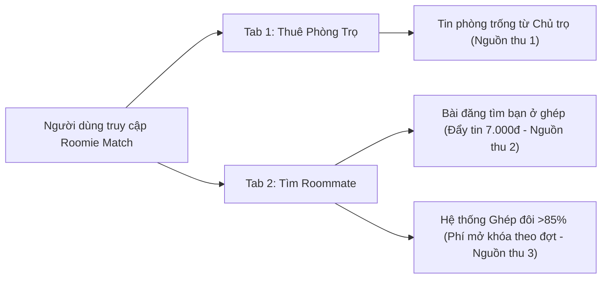
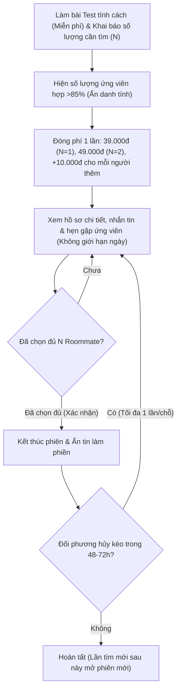

# Roomie Match — Startup Overview

> **Tuyên ngôn định vị:** *"Tìm đúng phòng, ghép đúng người — Sống chung bình yên."*  
> Nếu các nền tảng bất động sản truyền thống chỉ giúp người dùng tìm **mặt bằng**, **Roomie Match** giải quyết trọn vẹn cả hai bài toán: **minh bạch chi phí phòng trọ** và **ghép đôi bạn cùng phòng tương hợp lối sống (>85%)**.

---

## 1. Bối cảnh & Nỗi đau thị trường (Problem Statement)

Tại các đô thị lớn (TP.HCM, Hà Nội, Đà Nẵng...), sinh viên và người mới đi làm gặp 3 rào cản lớn khi tìm chỗ ở:

1. **Tìm roommate hên xui, dễ vỡ kèo sau khi dọn vào:** Trên các hội nhóm Facebook/Zalo, bài đăng trôi nhanh chỉ sau vài giờ; người tìm bạn chỉ đọc vài dòng mô tả cảm tính mà thiếu thông tin chuẩn hóa về giờ sinh hoạt, độ sạch sẽ, thói quen dẫn bạn về phòng hay chia sẻ đồ dùng.
2. **Giá phòng mập mờ, nhiều chi phí ẩn:** Nhiều tin đăng treo giá phòng thấp để câu khách nhưng khi đến xem mới phát sinh điện, nước, rác, wifi, gửi xe, thang máy làm tổng chi phí đội lên đáng kể.
3. **Thiếu niềm tin & rào cản phí đăng tin của chủ trọ:** Người thuê sợ tin ảo, cò mồi, lừa tiền cọc; trong khi chủ trọ lại ngại các nền tảng thu phí duy trì định kỳ mỗi tháng dù chưa biết bao giờ mới có khách thuê.

---

## 2. Nhóm khách hàng mục tiêu (Target Users)

Roomie Match kết nối **3 nhóm người dùng** trong cùng một hệ sinh thái:

| Nhóm người dùng | Nhu cầu chính | Hành động trên website |
| :--- | :--- | :--- |
| **1. Chủ sở hữu (Chủ trọ)** | Lấp phòng trống nhanh, tiếp cận khách thuê uy tín, chi phí đăng tin rõ ràng và hợp lý. | Đăng bài giới thiệu **từng phòng trống cụ thể** (giá, diện tích, tiện ích, nội quy), nhận liên hệ trực tiếp từ người thuê. |
| **2. Người cần thuê trọ** | Tìm phòng đúng ngân sách thực tế, không qua môi giới ảo; hoặc tìm bạn cùng đi thuê phòng mới. | Lọc và xem chi tiết tổng chi phí phòng trống, liên hệ trực tiếp chủ trọ; hoặc làm bài test để ghép roommate thuê chung. |
| **3. Người đã có trọ cần tìm Roommate** | Chia sẻ tiền phòng và sinh hoạt phí với người hợp tính cách, tuân thủ nội quy sẵn có. | Đăng bài chi tiết về phòng đang ở (địa chỉ, tổng chi phí, thói quen, quy định phải chấp hành) và chân dung roommate mong muốn (giới tính, tính cách). |

---

## 3. Kiến trúc Sản phẩm & Tính năng Cốt lõi

### 3.1. Tách biệt 2 Không gian hoạt động (Chống xung đột quyền lợi)

Website tách rõ 2 tab tìm kiếm độc lập để tin trả phí của chủ trọ và tin đẩy ưu tiên của người tìm roommate không đè lên nhau:

### 3.2. Bộ giải pháp tạo khác biệt (USP)

* **Thuật toán Match 2 lớp (Compatibility Engine > 85%):**
  * **Lớp 1 — Lọc cứng (Deal-breakers bắt buộc khớp):** Giới tính, tổng ngân sách tối đa/tháng, khu vực/bán kính tới trường hoặc nơi làm việc, hút thuốc, nuôi thú cưng, giờ giới nghiêm.
  * **Lớp 2 — Chấm điểm lối sống (Lifestyle Compatibility):** Giờ ngủ/dậy (cú đêm vs dậy sớm), mức độ sạch sẽ & tần suất dọn dẹp, nhạy cảm tiếng ồn (call/game đêm), thói quen đưa bạn bè/người yêu về phòng, nấu ăn chung hay riêng, nhu cầu giao tiếp hay tôn trọng không gian riêng.
  * **Hiển thị trực quan:** Trả về % tương hợp kèm lý do cụ thể cho từng tiêu chí thay vì chỉ gắn nhãn tính cách chung chung.
* **Bảng dự toán "Tổng chi phí thực tế / người / tháng":**
  * Form đăng tin chuẩn hóa buộc người đăng nhập tách bạch: tiền phòng + điện + nước + internet + giữ xe + phí dịch vụ $\rightarrow$ Hệ thống tự cộng ra tổng số tiền thực đóng hàng tháng để người xem so sánh công bằng ngay lập tức.
* **Hệ thống Tin cậy & An toàn (Trust & Safety):**
  * Huy hiệu **Sinh viên xác thực** (qua email `.edu.vn` hoặc thẻ sinh viên) giúp tăng độ an tâm khi ở ghép.
  * Huy hiệu **Tin Xác Thực** cho chủ trọ (kiểm duyệt thông tin, hình ảnh thực tế) và cơ chế báo cáo tin ảo/phòng đã cho thuê.

---

## 4. Mô hình Kinh doanh & Cơ chế Xử lý Tình huống

> **Nguyên tắc cốt lõi:** Giảm ma sát gia nhập bằng dùng thử/test miễn phí và **không ép gia hạn định kỳ**, nhưng khóa chặt các lỗ hổng vận hành để bảo vệ chất lượng dữ liệu và doanh thu lặp lại.

### 4.1. Tổng hợp 3 Nguồn thu

| Nguồn thu | Đối tượng áp dụng | Chính sách giá & Quyền lợi | Hình thức thu |
| :--- | :--- | :--- | :--- |
| **1. Đăng tin phòng trống** | **Chỉ Chủ sở hữu (Chủ trọ)** | • **Miễn phí:** 1 tin đầu tiên (hiển thị **7 ngày**). • **Gói Tin Xác Thực:** **100.000đ / 1 phòng** (1 bài đăng = 1 phòng, không giới hạn thời hạn hiển thị). | Thu **1 lần duy nhất** cho phòng đó. |
| **2. Đẩy tin ưu tiên** | **Chỉ Người tìm Roommate** | • **7.000đ / lượt đẩy tin** lên đầu danh sách *Tìm Roommate* trong **24 giờ**. | Micro-payment theo từng lượt đẩy (có thể kèm combo 3 ngày / 7 ngày). |
| **3. Ghép Roommate nâng cao (> 85%)** | **Người tìm Roommate** | • Làm bài test tính cách **miễn phí**. • **Tìm 1 roommate:** **39.000đ** • **Tìm 2 roommate:** **49.000đ** • **Từ 2 roommate trở lên:** **+10.000đ / roommate thêm** *(3 người: 59.000đ, 4 người: 69.000đ...)* • Mở khóa danh sách đề xuất >85%, xem hồ sơ chi tiết và nhắn tin lựa chọn. | **Pay-per-Match-Session:** Không giới hạn số ngày trong phiên đang tìm; **kết thúc khi đã chọn đủ số roommate của phiên** (lần tìm khác sau này đóng lượt phí mới). |

### 4.2. Luồng xử lý các tình huống & Lỗ hổng vận hành

#### A. Xử lý lỗ hổng cho Nguồn thu 1 (Tin 100.000đ không thời hạn)
* **Rủi ro 1 — "Phòng ma" (phòng đã cho thuê xong nhưng chủ lười gỡ tin):** Gây mất uy tín khi người thuê gọi tới toàn báo hết phòng.
  * *Cách xử lý:* Tách biệt "không hết hạn gói" với **Trạng thái phòng (Còn trống / Đã lấp đầy)**. Hệ thống gửi **Ping xác nhận định kỳ mỗi 10–14 ngày** qua Email/Zalo chỉ cần 1 chạm (*"Phòng này vẫn còn trống?"*). Nếu sau 48 giờ chủ trọ không xác nhận, tin tự động chuyển sang **Tạm ẩn** để giữ sạch dữ liệu tìm kiếm.
* **Rủi ro 2 — Lách luật dùng 1 gói 100k quay vòng cho nhiều phòng khác nhau:** Chủ trọ sửa ảnh, giá phòng A thành phòng B để né phí.
  * *Cách xử lý:* **Khóa cứng định danh phòng** (địa chỉ + mã/số phòng) sau khi đã kích hoạt gói Tin Xác Thực 100.000đ.

#### B. Xử lý lỗ hổng cho Nguồn thu 2 (Đẩy tin 7.000đ/24h)
* **Rủi ro — Loãng tin đẩy vào giờ cao điểm:** Nếu quá nhiều người cùng đẩy tin một lúc, tin vừa đẩy đã bị trôi ngay.
  * *Cách xử lý:* Giới hạn số lượng **slot tin đẩy ưu tiên** hiển thị cố định trên đầu trang *Tìm Roommate* (luân phiên công bằng trong các tin đang active 24h) và tách biệt hoàn toàn khỏi tab *Thuê Phòng Trọ*.

#### C. Xử lý lỗ hổng cho Nguồn thu 3 (Pay-per-Match-Session theo số lượng Roommate)

* **Rủi ro 1 — Gian lận số lượng roommate cần tìm:** User đóng gói 1 người (39.000đ) nhưng thực tế tìm nhiều người cùng lúc hoặc kéo dài vô thời hạn.
  * *Cách xử lý:* User phải **khai báo số lượng roommate ($N$) ngay lúc mở phiên** (khớp với số chỗ trống trên bài đăng nếu đã có phòng). Hệ thống chỉ cho xác nhận tối đa $N$ ghép đôi trong phiên đó; khi đủ $N$ người, phiên tự động đóng.
* **Rủi ro 2 — User chốt roommate ngoài đời (qua Zalo) rồi "quên/cố tình không bấm" kết thúc phiên:**
  * *Cách xử lý:* Tạo quyền lợi trực tiếp cho nút **"Xác nhận ghép đôi thành công"**: khi cả 2 cùng bấm xác nhận, hệ thống tự động ẩn bài đăng/hồ sơ để tránh bị người lạ nhắn tin làm phiền tiếp, đồng thời tặng kèm tài liệu hữu ích (*Mẫu thỏa thuận ở ghép / Bảng mẫu chia chi phí phòng*). Kết hợp **Ping kiểm tra mỗi 30 ngày** nếu phiên mở quá lâu không có tương tác.
* **Rủi ro 3 — Vừa bấm chọn roommate xong thì đối phương hủy kèo phút chót:**
  * *Cách xử lý:* Áp dụng **Chính sách Bảo hành 48–72 giờ** — cho phép hoàn tác trạng thái xác nhận (tối đa 1 lần cho mỗi vị trí) nếu đối phương hủy kèo trước khi dọn vào ở, giúp user quay lại danh sách cũ chọn người tiếp theo mà không bị thu phí lại oan.

---

## 5. So sánh Đối thủ cạnh tranh (Competitive Positioning)

| Tiêu chí | Hội nhóm Facebook / Zalo | Chợ Tốt Nhà / Phongtro123 / Trọ Mới | Ohana | **Roomie Match** |
| :--- | :--- | :--- | :--- | :--- |
| **Mục đích chính** | Rao vặt tự phát | Rao vặt BĐS & phòng cho thuê quy mô lớn | Tìm phòng & ở ghép cho giới trẻ | **Tìm phòng minh bạch & Ghép đôi Roommate theo lối sống** |
| **Lọc tính cách & lối sống** | Không (tự đọc và đoán) | Sơ sài (giá, quận, giới tính) | Cơ bản (hút thuốc, thú cưng, giờ giấc) | **Sâu: Test 2 lớp & tính % tương hợp (>85%)** |
| **Minh bạch tổng chi phí** | Kém (hay ẩn phí phụ) | Trung bình | Khá tốt | **Bắt buộc tách bạch & tự tính tổng/người/tháng** |
| **Chính sách phí cho chủ trọ** | Miễn phí | Thu theo gói ngày/VIP định kỳ | Thu phí/đẩy tin | **Free 7 ngày đầu + 100k/phòng (1 lần, không thời hạn)** |
| **Trải nghiệm tìm lại tin** | Kém (trôi bài liên tục) | Tốt | Tốt | **Tự động gợi ý ứng viên mới khớp >85%** |

---

## 6. Chiến lược Tiếp cận thị trường (Go-to-Market)

Để giải bài toán **"Con gà & Quả trứng"** của sàn giao dịch 2–3 chiều, Roomie Match không rải quảng cáo diện rộng ngay từ đầu mà đánh theo chiến lược **"Vết dầu loang" (Hyper-local Beachhead)**:

1. **Giai đoạn 1 — Khởi tạo Nguồn cung tập trung (Tuần 1–4):**
   * Chọn duy nhất **1 cụm trường ĐH mật độ cao** (ví dụ: Làng ĐH Thủ Đức hoặc cụm Quận 5 – Quận 10).
   * Tận dụng chính sách **Miễn phí 1 tin đầu (7 ngày)** để kéo 30–50 chủ trọ đầu tiên đưa phòng thật lên web; kết hợp tuyển nhóm sinh viên đang cần tìm bạn ở ghép làm dữ liệu mồi chất lượng.
2. **Giai đoạn 2 — Viral Hook qua Bài Test Tính Cách (Tháng 2–3):**
   * Tập trung vào cao điểm mùa nhập học (tháng 8–10) và sau Tết (tháng 2–3).
   * Đóng gói kết quả test miễn phí thành **Thẻ cá tính ở trọ (Shareable Card)** mang phong cách ấm cúng của nhận diện thương hiệu (ví dụ: *"Hệ Cú Đêm Sạch Sẽ — Cần bạn cùng phòng thích yên tĩnh"*) để sinh viên chia sẻ lên Story/Threads/Group trường, kéo lượng truy cập tự nhiên với chi phí marketing tối thiểu.
3. **Giai đoạn 3 — Kích hoạt chuyển đổi & Nhân bản (Từ Tháng 4 trở đi):**
   * Khi chủ trọ đã nhận thấy khách thật nhắn tin từ gói dùng thử 7 ngày, tỷ lệ chuyển đổi sang gói **100.000đ xác thực** tăng mạnh.
   * Khi mật độ hồ sơ tại cụm đầu tiên đủ dày, kích hoạt tự nhiên nhu cầu đẩy tin **7.000đ** và mở khóa **Match > 85%** (39.000đ / 49.000đ+), sau đó nhân bản mô hình sang các quận/cụm trường tiếp theo.

---

## 7. Minh họa Đơn vị Kinh tế (Kịch bản giả định 1 cụm khu vực / tháng)

> **Lưu ý:** Các con số dưới đây là **kịch bản giả định minh họa** nhằm kiểm tra tính khả thi tài chính ở quy mô thử nghiệm 1 cụm trường, chưa phải số liệu vận hành thực tế.

* **Nguồn 1:** 100 phòng nâng cấp Tin Xác Thực × 100.000đ = **10.000.000đ**
* **Nguồn 2:** 400 lượt đẩy tin tìm roommate × 7.000đ = **2.800.000đ**
* **Nguồn 3:** 120 lượt tìm 1 roommate × 39.000đ + 30 lượt tìm 2 roommate × 49.000đ = **6.150.000đ**
* **Tổng doanh thu ước tính ở quy mô nhỏ:** **18.950.000đ / tháng** — đủ trang trải hạ tầng server, kiểm duyệt và chi phí marketing cơ bản trong giai đoạn khởi nghiệp tinh gọn.

---

## 8. Lộ trình Triển khai Tiếp theo (Next Steps)

1. **Chốt thiết kế Bài test Tính cách & Công thức chấm điểm > 85%:** Xác định bộ 10–15 câu hỏi trọng số cao, không gây chán cho người dùng.
2. **Xây dựng User Flow & Wireframe UI/UX:** Thiết kế giao diện Mobile-first áp dụng hệ thống thiết kế trong [`info/DESIGN.md`](info/DESIGN.md) (bảng màu `#635BFF` / `#B8F2D5` / `#16866A`, font `Be Vietnam Pro`) kết hợp logo [`info/logo.png`](info/logo.png) cho 2 tab *Thuê Phòng Trọ* và *Tìm Roommate*.
3. **Phát triển MVP (Minimum Viable Product):** Tập trung đúng 4 luồng cốt lõi: Đăng tin phòng (tính tổng chi phí) – Đăng tin tìm roommate – Làm test & tính % Match – Tích hợp thanh toán VietQR cho 3 nguồn thu.
